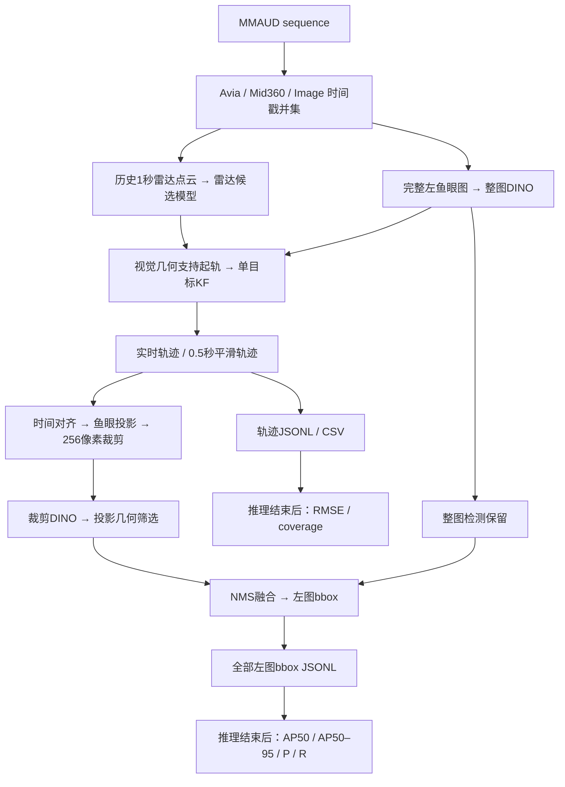

# rdq-uav-final

独立的MMAUD无人机雷达与左鱼眼视觉处理工程。源码、最佳模型权重、初始化权重、相机标定、固定参数、数据读取约定、引用工程与验证记录均收在本目录。外部输入仅为MMAUD数据集；不需要旧项目目录。

## 1. 快速运行

在Python 3.10、PyTorch CUDA环境中执行：

```bash
cd /home/jasoncui/projects/rdq-uav-final
conda activate rdq
python run.py doctor

# 推荐：按传感器时间戳处理完整验证sequence，覆盖所有左图
python -u run.py infer \
  --data-root /home/jasoncui/datasets/MMAUD/official/train \
  --split validation_sub --schedule sensor \
  --output runs/final_validation_sensor

# 历史实验协议复现：GT文件名定义查询时间，不使用GT值选择输出
python -u run.py infer \
  --data-root /home/jasoncui/datasets/MMAUD/official/train \
  --split validation_sub --schedule benchmark \
  --output runs/final_validation_benchmark

# 指定sequence，或处理数据根目录下全部sequence
python -u run.py infer --data-root /home/jasoncui/datasets/MMAUD/official/train \
  --sequences seq0020 --output runs/seq0020_full
python -u run.py infer --data-root /home/jasoncui/datasets/MMAUD/official/train \
  --split all --output runs/all_sequences
```

每次使用新的输出目录。神经网络推理与训练要求GPU，不自动回退CPU。KF、时间对齐、文件整理和指标计算使用CPU。首次换机器安装见 `docs/INSTALL.md`。

## 2. 端到端流程



这是统一入口的多阶段系统，**不是端到端联合训练网络**。最终方案不新增网络结构：视觉辅助雷达起轨，雷达轨迹再辅助视觉裁剪。实时与0.5秒平滑两种输出均保留。平滑分支是离线有界前视批处理，不能称为零延迟实时。

## 3. 输入与输出

输入目录结构：

```text
MMAUD/official/train/
  seqXXXX/
    livox_avia/<timestamp>.npy
    lidar_360/<timestamp>.npy
    Image/<timestamp>.png
    ground_truth/<timestamp>.npy   # 只用于评分；benchmark还用文件名定义时间轴
    2d_detect/<timestamp>.txt      # 只用于训练监督/评分，不是视觉推理输入
```

沿用当前项目的MMAUD released XYZ坐标约定，两路点云目录保持原含义；不根据名称宣称为原始雷达ADC或重新进行传感器坐标转换。PNG若为2560×960双目拼接，仅取左侧1280×960。bbox为**左图原始像素xyxy**，非缩放图或右图坐标。

输出：

```text
runs/新目录/
  run_status.json               # 全流程完成标记、时间轴、是否smoke
  metrics.json                  # 全局RMSE、coverage；图像AP为全图池化计算
  seqXXXX/
    trajectory.jsonl / .csv     # 时间戳、实时xyz、lag05 xyz、速度、事件与前视时间
    bboxes.jsonl                # 每张左图，realtime/lag05各自boxes与scores
    metrics.json               # sequence指标和图像覆盖统计
    cache/                     # GPU候选与整图预测，可诊断复放
    tracks/                    # KF完整诊断记录
    priors/                    # 图像时刻位置投影与crop
    image_eval/                # 各图像方法的固定预测
```

有图片但没有轨迹先验时仍输出整图检测。没有有效目标轨迹时xyz为null，按缺失报告，不能用GT填轨迹或将缺失从coverage分母删除。`--limit-queries`仅供冒烟，不代表完整覆盖。

## 4. 验证口径与已有结果

**历史query benchmark**（3条验证sequence，共1200查询；不是全传感器时间轴）：

| 分支 | 3D RMSE | 轨迹输出coverage |
|---|---:|---:|
| 视觉支持起轨＋实时KF | 0.59284 m | 1190/1200 |
| 同上＋0.5秒平滑 | 0.53308 m | 1200/1200 |

历史已查看的另3条sequence事后探索：实时0.60156m，平滑0.56724m；不能再次称为未接触的独立测试。

人工修订验证GT：1195图中1158有效，37不确定整图排除。使用已有完全相同预测重新评分：

| 图像分支 | AP50 | AP50–95 | Precision | Recall |
|---|---:|---:|---:|---:|
| 整图Top50 | 87.91% | 32.08% | 92.11% | 92.75% |
| 实时轨迹裁剪＋筛选 | 87.78% | 31.76% | 89.54% | 93.18% |
| 0.5秒轨迹裁剪＋筛选 | 89.01% | 32.25% | 90.11% | 93.61% |

P/R：confidence≥0.25、IoU≥0.5、每图最多100预测；AP使用完整预测排序与COCO标准。参考结果及其原输入SHA在`reference/`。人工标注参考了整图模型，不是与模型独立的测试GT，换标注产生的涨幅不能算模型能力进步。

**完整sensor模式是新的时间轴**，采样更密且观测相关性不同，因此不能保证直接继承上述RMSE/AP。该模式完全遍历Image和两路点云文件名时间并集，推理不读取GT数组/2D标签。指标只在推理结束后计算：实时状态向GT时刻因果外推（最多0.25秒），平滑轨迹在GT时刻做明确标记的离线插值（最大间隔0.25秒、不跨起轨）。最终完整指标以你这次验证的新输出为准。

## 5. 人工GT与原数据

训练和评分统一读取输入MMAUD目录中的`seqXXXX/2d_detect/<timestamp>.txt`，没有工程内第二份GT，也不覆盖数据集中后来修改的框。缺失或空标签表示不提供2D监督，图片仍参与推理，但不作为背景负样本或计入有GT检测评价分母。

当前MMAUD已写入351个人工修订框；37张不确定图片的原标注已移至数据集`_annotation_review_archive/20261017_overlay_removed/uncertain_labels/`，从活动`2d_detect`目录中移出。人工审核历史也在该归档目录的`review_exports/`，最终工程不读取归档。使用另一份MMAUD时，其标注就是唯一依据，不会被工程内旧标注覆盖。

## 6. 从训练到推理

详见 `docs/TRAINING.md`。最终模型与初始化资产都在工程内：

| 文件 | 用途 |
|---|---|
| `weights/radar.ckpt` | 已验证雷达候选模型 |
| `weights/radar_warmstart.ckpt` | 雷达训练A2初始化 |
| `weights/vision_full.ckpt` | 已验证B4训练得到的整图DINO分支 |
| `weights/vision_crop.ckpt` | 已验证混合裁剪训练last权重；不是best_ap |
| `checkpoints/dino_swin_t/*.pth` | COCO初始化，供重训视觉使用 |

最终权重推断不需要重训。训练新权重后用`infer --radar-checkpoint ... --full-checkpoint ... --crop-checkpoint ...`显式选择工程内权重；不自动覆盖冻结基线。

## 7. 代码目录

```text
run.py                                  # 统一入口
src/rdq_uav/__init__.py                  # Python包标识
src/rdq_uav/multimodal_v3/
    modeling/                           # 模型、数据读取、几何和训练运行时
    pipeline/                           # 候选提取、跟踪、图像检测与评估
    training/                           # 训练入口与权重加载
    runtime_paths.py                    # 工程路径解析
    *.py                                # KF、视觉起轨、裁剪与检测算法
configs/final/                 # 所有正式流程配置
configs/calibration/           # 相机内参与畸变
calibration/                   # 外参与时间约定
tests/                         # 统一测试
```

正式子流程通过`python -m rdq_uav.multimodal_v3.pipeline.…`或`rdq_uav.multimodal_v3.training.…`执行，run.py会设置项目源码路径。历史实验目录及旧版源码目录已删除，正式流程仅使用上述模块与配置。模型类名和参数键保留，以兼容已验证权重；`modeling/`不是另一个旧工程依赖。

## 8. 工程边界

- 运行逻辑不引用其它工程路径。detrex/detectron2完整源码与本地CUDA扩展、Stone Soup源码都在`third_party/`；标准Python/CUDA运行环境由依赖文件说明。
- 标定数值在`configs/calibration/`与`calibration/`，是既有固定参数，不在最终验证集上重拟合。历史拟合CSV未在原源码快照提供，因此只提供冻结结果与坐标/时间约定，不声称可复现原标定拟合过程。
- `MANIFEST.json`含源码/配置/权重SHA256。doctor核对来源与文件完整性，`tests/`包含全图、评分与因果性检查；测试与GPU实测见`VALIDATION.md`。
